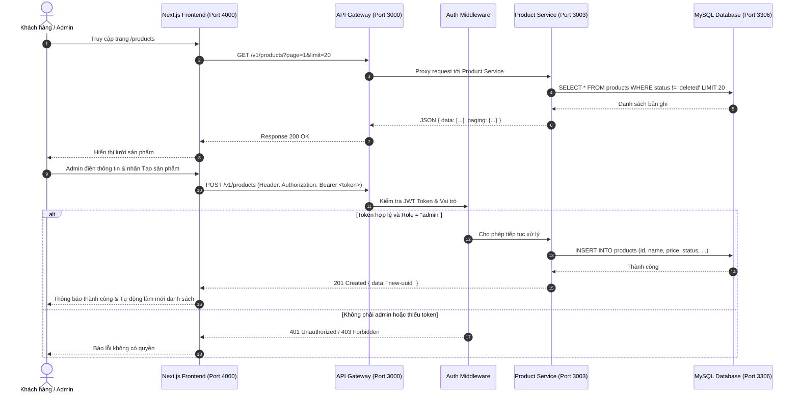

# TÀI LIỆU KHẢO SÁT DỰ ÁN & PHÂN TÍCH TÍCH HỢP PRODUCT CRUD
**Mã tài liệu:** `00_PROJECT_ANALYSIS.md`  
**Giai đoạn:** Giai đoạn 0 — Khảo sát dự án trước khi lập trình  
**Trạng thái:** Hoàn thành  
**Mục tiêu:** Khảo sát toàn diện mã nguồn hiện có của Backend và Frontend, xác định kiến trúc Product, danh sách API, schema dữ liệu, cơ chế xác thực/phân quyền, các file cần sửa và ranh giới an toàn không xâm phạm chức năng khác.

---

## 1. Cấu trúc thực tế của Frontend và Backend

Khảo sát cấu trúc thư mục thực tế trong repository:

```text
Express-Microservices/
├── backend/
│   ├── docker/
│   │   ├── Dockerfile.brand
│   │   ├── Dockerfile.cart
│   │   ├── Dockerfile.category
│   │   ├── Dockerfile.gateway
│   │   ├── Dockerfile.order
│   │   ├── Dockerfile.product
│   │   └── Dockerfile.user
│   ├── scripts/
│   │   ├── dev-all.js           # Khởi động đồng thời tất cả microservices & gateway
│   │   └── migrate.ts           # Chạy sync/alter schema các bảng database
│   ├── src/
│   │   ├── docs/
│   │   │   └── swagger.ts       # Swagger UI & OpenAPI 3.0 spec cho toàn bộ API
│   │   ├── gateway/
│   │   │   └── index.ts         # Reverse proxy chuyển tiếp request tới từng microservice
│   │   ├── modules/
│   │   │   ├── brand/           # Microservice Brand (Port 3001)
│   │   │   ├── cart/            # Microservice Cart (Port 3005)
│   │   │   ├── category/        # Microservice Category (Port 3002)
│   │   │   ├── order_items/     # Sub-module quản lý item trong order
│   │   │   ├── orders/          # Microservice Order (Port 3006)
│   │   │   ├── product/         # Microservice Product (Port 3003)
│   │   │   └── user/            # Microservice User & Auth (Port 3004)
│   │   ├── share/               # Tầng dùng chung (Sequelize, Middleware Auth, Base Model)
│   │   └── index.ts             # Monolithic entrypoint (chạy tất cả module trên Port 3000)
│   ├── terraform/               # Cấu hình Terraform cho AWS RDS / Render
│   ├── docker-compose.yml       # Điều phối container các service cục bộ
│   ├── package.json
│   ├── tsconfig.json
│   └── .env.example
│
├── frontend/
│   ├── app/                     # Next.js 16 App Router
│   │   ├── cart/page.tsx
│   │   ├── login/page.tsx
│   │   ├── payment/page.tsx
│   │   ├── products/
│   │   │   ├── [id]/page.tsx
│   │   │   └── page.tsx
│   │   ├── register/page.tsx
│   │   ├── globals.css
│   │   ├── layout.tsx
│   │   └── page.tsx             # Trang chủ
│   ├── components/
│   │   ├── pages/
│   │   │   ├── auth-page.tsx
│   │   │   ├── cart-page.tsx
│   │   │   ├── home-page.tsx
│   │   │   ├── payment-page.tsx
│   │   │   ├── product-detail-page.tsx
│   │   │   └── products-page.tsx
│   │   ├── ui/
│   │   │   └── button.tsx
│   │   └── storefront.tsx       # Component SPA chính quản lý toàn bộ view & state giao diện
│   ├── lib/
│   │   └── utils.ts             # Helper cn (clsx + tailwind-merge)
│   ├── package.json
│   ├── pnpm-lock.yaml
│   └── .env.example
│
└── README.md
```

---

## 2. Kiến trúc Backend & Luồng dữ liệu

### 2.1. Kiến trúc Hexagonal (Ports & Adapters)
Backend xây dựng theo mô hình **Hexagonal Architecture**:
- **Domain Model / Entities:** `src/modules/product/model/product.ts`
- **Use Cases (Business Logic):** `src/modules/product/usecase/index.ts`
- **Ports (Interfaces):** `src/modules/product/interface/index.ts`
- **Adapters Infras:**
  - **Inbound / Transport:** `src/modules/product/insfra/transport/http-service.ts` (Express Controller)
  - **Outbound / Repository:** `src/modules/product/insfra/repository/mysql/repository.ts` (Sequelize ORM)
  - **Outbound / RPC:** `src/modules/product/insfra/repository/rpc/repository.ts` (Gọi Brand/Category service qua HTTP)

### 2.2. Hai chế độ chạy của Backend
1. **Chế độ Microservices (`npm run dev:all` hoặc Docker Compose):**
   - API Gateway chạy trên cổng `3000`.
   - Các service độc lập: `Product Service` (3003), `User Service` (3004), `Brand Service` (3001), `Category Service` (3002), `Cart Service` (3005), `Order Service` (3006).
   - Gateway nhận request tại `/v1/products` và proxy sang `http://localhost:3003/v1/products`.
2. **Chế độ Monolith (`npm run dev`):**
   - `src/index.ts` kết nối trực tiếp database và nạp tất cả các router vào một instance Express duy nhất tại cổng `3000`.

---

## 3. Danh sách API Product hiện có trong Backend

| HTTP Method | Endpoint | Trạng thái | Yêu cầu xác thực | Vai trò | Chức năng |
| :--- | :--- | :--- | :--- | :--- | :--- |
| `GET` | `/v1/products` | Đã có | Public (storefront) | Khách / Admin | Lấy danh sách sản phẩm (phân trang: `page`, `limit`, lọc: `fromPrice`, `toPrice`, `brandId`, `categoryId`) |
| `GET` | `/v1/products/:id` | Đã có | Public (storefront) | Khách / Admin | Lấy thông tin chi tiết một sản phẩm theo UUID |
| `POST` | `/v1/products` | Đã có | Cần gắn auth | Admin | Tạo sản phẩm mới |
| `PATCH` | `/v1/products/:id` | Đã có | Cần gắn auth | Admin | Cập nhật thông tin sản phẩm |
| `DELETE` | `/v1/products/:id` | Đã có | Cần gắn auth | Admin | Xóa mềm sản phẩm (chuyển status thành `deleted`) |

### Cấu trúc request / response thực tế:

#### 1. Lấy danh sách sản phẩm: `GET /v1/products?page=1&limit=10`
- **Response Success (200 OK):**
```json
{
  "data": [
    {
      "id": "018e38d7-7f91-7294-b715-d41935824b21",
      "name": "Classic Wool Coat",
      "gender": "unisex",
      "price": 249.99,
      "salePrice": 199.99,
      "colors": "Camel, Black",
      "quantity": 25,
      "brandId": "018e38d7-7f91-7294-b715-d41935824b10",
      "categoryId": "018e38d7-7f91-7294-b715-d41935824b01",
      "description": "Tailored outerwear in virgin wool",
      "content": "Detailed care instructions",
      "rating": 0,
      "saleCount": 0,
      "status": "active",
      "createdAt": "2026-10-18T00:00:00.000Z",
      "updatedAt": "2026-10-18T00:00:00.000Z"
    }
  ],
  "paging": {
    "page": 1,
    "limit": 10,
    "total": 1
  },
  "filter": {}
}
```

#### 2. Lấy chi tiết sản phẩm: `GET /v1/products/:id`
- **Response Success (200 OK):**
```json
{
  "data": {
    "id": "018e38d7-7f91-7294-b715-d41935824b21",
    "name": "Classic Wool Coat",
    "gender": "unisex",
    "price": "249.99",
    "salePrice": "199.99",
    "colors": "Camel, Black",
    "quantity": 25,
    "brandId": "018e38d7-7f91-7294-b715-d41935824b10",
    "categoryId": "018e38d7-7f91-7294-b715-d41935824b01",
    "description": "Tailored outerwear in virgin wool",
    "content": "Detailed care instructions",
    "rating": 0,
    "saleCount": 0,
    "status": "active",
    "createdAt": "2026-10-18T00:00:00.000Z",
    "updatedAt": "2026-10-18T00:00:00.000Z"
  }
}
```
- **Response Lỗi (404 Not Found):**
```json
{
  "error": "Product not found"
}
```

#### 3. Tạo sản phẩm: `POST /v1/products`
- **Request Body (JSON):**
```json
{
  "name": "Cashmere Knit Sweater",
  "gender": "female",
  "price": 180.00,
  "salePrice": 150.00,
  "quantity": 30,
  "colors": "Cream, Charcoal",
  "brandId": "018e38d7-7f91-7294-b715-d41935824b10",
  "categoryId": "018e38d7-7f91-7294-b715-d41935824b01",
  "description": "Pure Mongolian cashmere crewneck",
  "content": "Dry clean only"
}
```
- **Response Success (201 Created):**
```json
{
  "data": "018e38d7-a123-7456-b715-d41935824b99"
}
```

#### 4. Xóa sản phẩm: `DELETE /v1/products/:id`
- **Cơ chế:** Soft Delete (chuyển `status = "deleted"` trong database).
- **Response Success (200 OK):**
```json
{
  "data": true
}
```

---

## 4. Những phần API còn thiếu hoặc cần bổ sung bảo vệ

1. **Bảo vệ quyền Admin cho `POST` và `DELETE`:**
   - Trong `src/modules/product/index.ts`, `authMiddleware` hiện đang bị comment out (`// router.use(authMiddleware);`).
   - Cần bổ sung middleware `authMiddleware` và `requireRoles("admin")` trực tiếp vào route `POST /products` và `DELETE /products/:id` để người dùng không có quyền admin hoặc chưa đăng nhập không thể gọi API thay đổi dữ liệu.
2. **Xử lý `authMiddleware` trong chế độ Monolith (`src/index.ts`):**
   - Trong `src/index.ts`, dòng 44: `app.use('/v1', authMiddleware);` được đặt trước cả `setUpProductHexagon`.
   - Nếu chạy monolith, việc này làm chặn cả `GET /v1/products` của khách vãng lai.
   - Cần lưu ý điều này khi kiểm thử môi trường monolith hoặc chạy qua API Gateway.

---

## 5. Cấu trúc dữ liệu Product thực tế

### 5.1. Bảng `products` trong cơ sở dữ liệu MySQL (Sequelize)
- `id`: `STRING` / `UUID` (Primary Key, sinh bằng UUID v7)
- `name`: `STRING` (Bắt buộc, tối thiểu 2 ký tự)
- `images`: `JSON` (Cho phép null)
- `price`: `DECIMAL(10,2)` (Bắt buộc, số dương)
- `sale_price` (`salePrice`): `DECIMAL(10,2)` (Bắt buộc, số không âm)
- `colors`: `STRING` (Cho phép null)
- `quantity`: `INTEGER` (Bắt buộc, mặc định 0, không âm)
- `brand_id` (`brandId`): `UUID` (Cho phép null)
- `category_id` (`categoryId`): `UUID` (Cho phép null)
- `description`: `STRING` (Cho phép null)
- `content`: `STRING` (Cho phép null)
- `gender`: `STRING` (Mặc định: `'unisex'`, enum: `'male' | 'female' | 'unisex'`)
- `status`: `STRING` (Mặc định: `'active'`, enum: `'active' | 'inactive' | 'deleted'`)
- `created_at` (`createdAt`): `DATETIME`
- `updated_at` (`updatedAt`): `DATETIME`

### 5.2. Kiểu dữ liệu trên Frontend (`frontend/components/storefront.tsx`)
- `ApiProduct`: Kiểu đối tượng trả về từ API backend.
- `Product`: Kiểu dùng trong giao diện hiển thị:
  - `id`: string
  - `brand`: string (mặc định `'LUMORA'` để không hiển thị UUID thô)
  - `name`: string
  - `category`: string
  - `price`: number
  - `image`: string (ánh xạ từ mảng ảnh mẫu `HARD_CODED_IMAGES` theo yêu cầu giữ nguyên giao diện)
  - `color`: string
  - `description`: string

---

## 6. Cơ chế xác thực và phân quyền Admin

Backend đã có sẵn hệ thống xác thực:
1. **Model User (`src/modules/user/model/index.ts`):**
   - `Role`: Enum gồm `'user'` và `'admin'`.
   - `Status`: Enum gồm `'active'`, `'pending'`, `'inactive'`, `'banned'`, `'deleted'`.
2. **JWT Token (`src/modules/user/usecase/index.ts`):**
   - Token sinh ra khi đăng nhập (`POST /v1/auth/login`) chứa payload:
     ```json
     {
       "sub": "user-uuid",
       "role": "admin"
     }
     ```
   - Ký bằng `JWT_SECRET` và có thời hạn `EXPIRATION_TIME` (mặc định 1h).
3. **Middleware kiểm tra (`src/share/middleware/auth.ts`):**
   - `authMiddleware`: Xác thực header `Authorization: Bearer <token>`, giải mã và gán `req.userId`, `req.userRole`, `req.requester`.
   - `requireRoles(...roles)`: Kiểm tra `req.userRole` có thuộc danh sách quyền yêu cầu (ví dụ `'admin'`). Nếu không, trả về `403 Forbidden`.

---

## 7. Các file dự kiến cần sửa và lý do

| File | Phân loại | Lý do sửa |
| :--- | :--- | :--- |
| `frontend/components/storefront.tsx` | Frontend | Kết nối API Product (danh sách, chi tiết, thêm/xóa cho Admin), giữ nguyên 100% giao diện sẵn có. |
| `frontend/components/pages/products-page.tsx` | Frontend | Tái sử dụng hoặc truyền props nếu cần thiết (hiện tại bọc `<Storefront initialView="products" />`). |
| `frontend/components/pages/product-detail-page.tsx` | Frontend | Hỗ trợ đọc ID từ URL và tải chi tiết sản phẩm tương ứng từ backend. |
| `frontend/app/products/[id]/page.tsx` | Frontend | Truyền `params.id` vào `ProductDetailPage` để tải đúng chi tiết sản phẩm khi reload trang hoặc mở link trực tiếp. |
| `backend/src/modules/product/index.ts` | Backend | Gắn `authMiddleware` và `requireRoles("admin")` cho các endpoint thay đổi dữ liệu `POST` và `DELETE`. |
| `backend/src/modules/product/insfra/transport/http-service.ts` | Backend | Đảm bảo trả status code và message lỗi chuẩn mực cho thao tác admin (nếu cần tinh chỉnh nhẹ mà không đổi schema). |

---

## 8. Những file tuyệt đối không được sửa

Theo quy tắc bắt buộc tại mục 3 của đề bài:
- **Giỏ hàng:** `backend/src/modules/cart/**`, `frontend/components/pages/cart-page.tsx`.
- **Thanh toán & Đơn hàng:** `backend/src/modules/orders/**`, `backend/src/modules/order_items/**`, `frontend/components/pages/payment-page.tsx`.
- **Hệ thống Auth sẵn có:** `backend/src/modules/user/**` (không thay đổi cấu trúc bảng, hash mật khẩu, jwt payload).
- **Hạ tầng & Cloud:** `backend/terraform/**`, `backend/docker/**`, `backend/docker-compose.yml`, các file cấu hình Render/AWS.
- **Brand & Category:** `backend/src/modules/brand/**`, `backend/src/modules/category/**`.

---

## 9. Các lệnh chạy Frontend, Backend và Database cục bộ

### 9.1. Yêu cầu môi trường
- **Node.js:** v22.x (máy hiện tại có `v22.23.2`)
- **NPM / PNPM:** `npm v10.9.8`, `pnpm v10.11.0`
- **MySQL:** Dịch vụ MySQL cục bộ đang chạy trên cổng `3306`.

### 9.2. Thứ tự khởi động Local

#### Bước 1: Chuẩn bị cơ sở dữ liệu MySQL
1. Mở MySQL Client / Workbench / CLI:
   ```sql
   CREATE DATABASE IF NOT EXISTS demo CHARACTER SET utf8mb4 COLLATE utf8mb4_unicode_ci;
   ```
2. Cấu hình biến môi trường tại `backend/.env`:
   ```env
   PORT=3000
   GATEWAY_PORT=3000
   PRODUCT_PORT=3003
   USER_PORT=3004
   BRAND_PORT=3001
   CATEGORY_PORT=3002
   CART_PORT=3005
   ORDER_PORT=3006

   BRAND_SERVICE_URL=http://localhost:3001
   CATEGORY_SERVICE_URL=http://localhost:3002
   PRODUCT_SERVICE_URL=http://localhost:3003
   USER_SERVICE_URL=http://localhost:3004
   CART_SERVICE_URL=http://localhost:3005
   ORDER_SERVICE_URL=http://localhost:3006

   DB_HOST=localhost
   DB_PORT=3306
   DB_USERNAME=root
   DB_PASSWORD=your_password
   DB_NAME=demo

   JWT_SECRET=just_jwt_secret_key
   EXPIRATION_TIME=1h
   ```
3. Chạy migration tạo bảng:
   ```powershell
   cd backend
   npm run db:migrate
   ```

#### Bước 2: Khởi động Backend
- **Tùy chọn A (Chế độ Microservices qua API Gateway - Khuyến nghị):**
  ```powershell
  cd backend
  npm run dev:all
  ```
  *(Hoặc chạy riêng Gateway và Product Service: `npm run dev:gateway` và `npm run dev:product` và `npm run dev:user`)*
- **Tùy chọn B (Chế độ Monolith):**
  ```powershell
  cd backend
  npm run dev
  ```

#### Bước 3: Khởi động Frontend
1. Cấu hình biến môi trường tại `frontend/.env.local`:
   ```env
   NEXT_PUBLIC_API_URL=http://localhost:3000
   ```
2. Cài đặt dependencies (nếu chưa có `node_modules`):
   ```powershell
   cd frontend
   pnpm install
   ```
3. Khởi động Next.js:
   ```powershell
   cd frontend
   pnpm run dev
   ```
   Frontend sẽ truy cập được tại `http://localhost:4000`.

---

## 10. Những vấn đề và thông tin cần lưu ý (Key Observations)

1. **Docker Desktop chưa khởi động:**
   - Khi kiểm tra bằng lệnh `docker ps`, Docker daemon chưa chạy. Do đó toàn bộ kiểm thử local sẽ chạy trực tiếp trên Node.js và MySQL Server native của máy Windows (cổng 3306 đang sẵn sàng).
2. **Cơ chế lưu token JWT của Admin trên giao diện:**
   - Hiện tại `frontend/components/storefront.tsx` chưa có chức năng lưu token thật sau khi đăng nhập (chỉ có form demo).
   - Để Admin có thể thực hiện thêm/xóa sản phẩm ở Giai đoạn 3 và 4, frontend cần một cơ chế lưu JWT token (ví dụ `localStorage` hoặc state) lấy từ endpoint `POST /v1/auth/login`, sau đó gửi kèm header `Authorization: Bearer <token>` khi gọi API quản trị.
3. **Giữ nguyên giao diện người dùng:**
   - Không được thay đổi style, font chữ, bố cục của trang `storefront.tsx`.
   - Các nút chức năng Admin (thêm sản phẩm, xóa sản phẩm) sẽ được tích hợp tinh tế, vừa vặn với phong cách tối giản thanh lịch của LUMORA Boutique.

---

## 11. Giải thích code và cách hoạt động (Tự học & Thuyết trình)

### A. Danh sách các file cốt lõi đã khảo sát
1. `backend/src/modules/product/insfra/transport/http-service.ts`: Bộ điều khiển HTTP nhận request, validate Zod schema và trả response JSON.
2. `backend/src/modules/product/usecase/index.ts`: Lớp nghiệp vụ xử lý logic tạo UUID, kiểm tra Brand/Category hợp lệ, gọi repository lưu dữ liệu hoặc xóa mềm.
3. `backend/src/modules/product/insfra/repository/mysql/repository.ts`: Tầng giao tiếp cơ sở dữ liệu qua Sequelize, thực hiện truy vấn phân trang và lọc dữ liệu.
4. `backend/src/share/middleware/auth.ts`: Middleware kiểm tra tính hợp lệ của token JWT và phân quyền `requireRoles`.
5. `frontend/components/storefront.tsx`: Component hiển thị sản phẩm, kết nối API lấy danh sách, xử lý giỏ hàng và điều hướng view.

### B. Giải thích các đoạn code quan trọng

#### 1. Xử lý phân trang và lọc sản phẩm trong Repository
Trích từ `backend/src/modules/product/insfra/repository/mysql/repository.ts`:
```typescript
async list(cond: ProductCondDTO, paging: PagingDTO): Promise<Product[]> {
    const { page, limit } = paging;
    const condSQL: any = { status: { [Op.ne]: ModelStatus.DELETED } };

    if (cond.brandId) condSQL.brandId = cond.brandId;
    if (cond.categoryId) condSQL.categoryId = cond.categoryId;
    if (cond.fromPrice !== undefined || cond.toPrice !== undefined) {
        const priceFilter: any = {};
        if (cond.fromPrice !== undefined) priceFilter[Op.gte] = cond.fromPrice;
        if (cond.toPrice !== undefined) priceFilter[Op.lte] = cond.toPrice;
        condSQL.price = priceFilter;
    }

    const total = await model.count({ where: condSQL });
    paging.total = total;
    const rows = await model.findAll({
        where: condSQL,
        offset: (page - 1) * limit,
        limit: limit,
        order: [['id', 'DESC']],
    });
    return rows.map((row) => row.get({ plain: true }));
}
```
- **Nhiệm vụ:** Tìm kiếm danh sách sản phẩm theo điều kiện lọc và phân trang.
- **Điểm mấu chốt:** Luôn có điều kiện `{ status: { [Op.ne]: ModelStatus.DELETED } }`. Điều này đảm bảo các sản phẩm đã bị xóa mềm sẽ không bao giờ xuất hiện trên storefront.
- **Tính toán phân trang:** Sử dụng `offset = (page - 1) * limit` và cập nhật `paging.total` để frontend biết tổng số sản phẩm phục vụ hiển thị số trang.

#### 2. Xóa mềm (Soft Delete) trong Usecase và Repository
Trích từ `backend/src/modules/product/usecase/index.ts`:
```typescript
async deleteProduct(id: string): Promise<boolean> {
    const product = await this.productQueryRepository.get(id);
    if (!product || product.status === ModelStatus.DELETED) {
        throw ErrDataNotFound;
    }
    await this.productCommandRepository.delete(id, false);
    return true;
}
```
- **Nhiệm vụ:** Kiểm tra sản phẩm có tồn tại và chưa bị xóa, sau đó gọi phương thức xóa mềm với tham số `isHard = false`.
- **Hành vi thực tế:** Database sẽ cập nhật trường `status` thành `'deleted'` thay vì chạy câu lệnh `DELETE FROM products WHERE id = ...`. Nhờ đó dữ liệu được bảo toàn tính toàn vẹn (không phá vỡ quan hệ với đơn hàng lịch sử).

#### 3. Middleware bảo vệ phân quyền Admin
Trích từ `backend/src/share/middleware/auth.ts`:
```typescript
export const requireRoles = (...roles: string[]) => {
    return (req: Request, res: Response, next: NextFunction): void => {
        const userRole = req.userRole || req.requester?.role;
        if (!userRole) {
            res.status(401).json({ message: "Unauthorized: User not authenticated" });
            return;
        }
        if (roles.length > 0 && !roles.includes(userRole)) {
            res.status(403).json({ message: "Forbidden: You do not have permission to access this resource" });
            return;
        }
        next();
    };
};
```
- **Nhiệm vụ:** Chặn đứng các request từ người dùng thông thường khi họ cố tình gọi API dành riêng cho quản trị viên. Trả về `403 Forbidden` nếu vai trò không khớp.

### C. Sơ đồ luồng xử lý (Mermaid Diagram)



### D. Câu hỏi có thể được giảng viên hỏi khi bảo vệ đồ án

1. **Câu hỏi:** *Tại sao trong hệ thống Microservices này lại dùng API Gateway thay vì để Frontend gọi thẳng vào cổng 3003 của Product Service?*
   - **Trả lời:** API Gateway đóng vai trò làm điểm truy cập duy nhất (Single Point of Entry) cho toàn bộ hệ thống client. Giúp che giấu cấu trúc mạng nội bộ, quản lý tập trung CORS, định tuyến và giảm thiểu việc client phải mở nhiều kết nối tới các cổng dịch vụ khác nhau.

2. **Câu hỏi:** *Vì sao xóa sản phẩm lại dùng Soft Delete thay vì Hard Delete (`DELETE FROM`)?*
   - **Trả lời:** Trong các hệ thống thương mại điện tử, sản phẩm có thể đã nằm trong giỏ hàng hoặc các đơn hàng đã thanh toán (`orders`, `order_items`). Nếu dùng Hard Delete, khóa ngoại (Foreign Key) sẽ bị vi phạm hoặc làm mất tính toàn vẹn lịch sử giao dịch. Soft Delete giúp sản phẩm biến mất khỏi giao diện bán lẻ nhưng vẫn giữ nguyên dữ liệu lịch sử kế toán.

3. **Câu hỏi:** *Nếu kẻ xấu tự tạo request bằng Postman gửi thẳng đến backend để thêm/xóa sản phẩm thì hệ thống ngăn chặn như thế nào?*
   - **Trả lời:** Hệ thống không chỉ ẩn nút trên giao diện frontend mà còn bảo vệ nhiều lớp ở backend bằng `authMiddleware` (kiểm tra tính hợp lệ và chữ ký của JWT) và `requireRoles("admin")` (kiểm tra claim `role` trong payload). Bất kỳ request nào không có chữ ký hợp lệ của server hoặc vai trò không phải `admin` đều bị backend từ chối với mã lỗi 401 hoặc 403.
