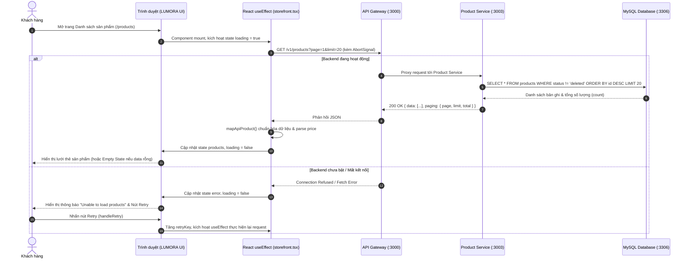

# TÀI LIỆU KẾT NỐI API & HIỂN THỊ DANH SÁCH SẢN PHẨM (PRODUCT LIST)
**Mã tài liệu:** `01_PRODUCT_LIST.md`  
**Giai đoạn:** Giai đoạn 1 — Kết nối Frontend với API và hiển thị danh sách Product  
**Trạng thái:** Hoàn thành (Đã rà soát & đối chiếu thực tế)  
**Mục tiêu:** Kết nối giao diện danh sách sản phẩm của Frontend với API `GET /v1/products` của Backend, hiển thị dữ liệu từ API, xử lý hoàn chỉnh các trạng thái: Đang tải (Loading), Báo lỗi kèm nút thử lại (Error with Retry), và Danh sách rỗng (Empty state), bảo toàn 100% bố cục và chức năng của thành viên khác.

---

## 1. Mục tiêu và phạm vi

### 1.1. Mục tiêu
- Kết nối logic nạp sản phẩm trong `frontend/components/storefront.tsx` vào endpoint backend `GET /v1/products`.
- Đọc địa chỉ API từ biến môi trường `NEXT_PUBLIC_API_URL` với fallback `http://localhost:3000` (API Gateway) khi chạy local.
- Giữ nguyên giao diện thương hiệu LUMORA hiện có (bố cục lưới, màu sắc, font chữ).
- Xử lý các trạng thái bất đồng bộ: Loading spinner, thông báo lỗi kết nối kèm nút Retry (thử lại tại chỗ mà không tải lại toàn bộ trang web), và trạng thái danh sách rỗng (Empty state).
- Đảm bảo kiểm tra kiểu dữ liệu TypeScript nghiêm ngặt (`tsc --noEmit`) và biên dịch dự án (`next build`) không phát sinh lỗi.

### 1.2. Ranh giới an toàn (Scope Boundaries)
- **Tuyệt đối không sửa:**
  - Logic giỏ hàng (`cart`, `add()`, `change()`, `CartView`).
  - Logic thanh toán (`PaymentView`, `payment-page.tsx`).
  - Logic xác thực (`AuthView`, `auth-page.tsx`, `user` service).
  - Các microservice khác (`brand`, `category`, `cart`, `orders`).
  - Cấu hình hạ tầng, Docker, Terraform, Cloud.
- **Chưa thực hiện ở giai đoạn này:**
  - Chi tiết sản phẩm động theo ID (Giai đoạn 2).
  - Quyền Admin tạo sản phẩm (Giai đoạn 3).
  - Quyền Admin xóa sản phẩm (Giai đoạn 4).

---

## 2. Báo cáo thay đổi Git & Phân loại file

Đối chiếu trực tiếp với `git status` và `git diff`:

```text
Changes not staged for commit:
  modified:   frontend/components/storefront.tsx
  modified:   frontend/next-env.d.ts
  modified:   frontend/tsconfig.tsbuildinfo

Untracked files:
  docs/product-crud/00_PROJECT_ANALYSIS.md
  docs/product-crud/01_PRODUCT_LIST.md
  docs/product-crud/PROGRESS.md
  frontend/.env.local (được .gitignore bảo vệ)
```

### Phân loại chi tiết:
1. **Mã nguồn chức năng được chỉnh sửa:**
   - [`frontend/components/storefront.tsx`](file:///e:/DIEN_TOAN_DAM_MAY/Express-Microservices/frontend/components/storefront.tsx): Tích hợp fetch API, fallback URL, xử lý giá Decimal, cơ chế `retryKey`, trạng thái loading/error/empty và ghi chú tiếng Việt có dấu.
2. **File cấu hình môi trường local mới tạo:**
   - `frontend/.env.local`: Khai báo `NEXT_PUBLIC_API_URL=http://localhost:3000`.
3. **Tài liệu theo dõi dự án trong `docs/`:**
   - [`docs/product-crud/00_PROJECT_ANALYSIS.md`](file:///e:/DIEN_TOAN_DAM_MAY/Express-Microservices/docs/product-crud/00_PROJECT_ANALYSIS.md): Khảo sát kiến trúc (Giai đoạn 0).
   - [`docs/product-crud/01_PRODUCT_LIST.md`](file:///e:/DIEN_TOAN_DAM_MAY/Express-Microservices/docs/product-crud/01_PRODUCT_LIST.md): Tài liệu kỹ thuật Giai đoạn 1.
   - [`docs/product-crud/PROGRESS.md`](file:///e:/DIEN_TOAN_DAM_MAY/Express-Microservices/docs/product-crud/PROGRESS.md): Bảng tiến độ tổng thể.
4. **Build artifacts tự động sinh:**
   - `frontend/next-env.d.ts`, `frontend/tsconfig.tsbuildinfo`: Do lệnh `npx tsc` và `npm run build` tự động cập nhật khi biên dịch cache.

---

## 3. Nội dung thay đổi trong code và lý do kỹ thuật

### File: `frontend/components/storefront.tsx`
1. **Fallback API URL an toàn:**
   - *Trước khi sửa:* `const API_BASE_URL = process.env.NEXT_PUBLIC_API_URL ?? ''`. Nếu không có file `.env`, Next.js sẽ gọi tới `http://localhost:4000/v1/products` và bị lỗi 404.
   - *Sau khi sửa:* `const API_BASE_URL = process.env.NEXT_PUBLIC_API_URL || 'http://localhost:3000'`, tự động trỏ về API Gateway cổng 3000 trong môi trường local.
2. **Cơ chế tải lại tại chỗ (Graceful Retry):**
   - *Trước khi sửa:* Nút Retry gọi `window.location.reload()`, ép tải lại toàn bộ trang và mất hết trạng thái client.
   - *Sau khi sửa:* Bổ sung state `retryKey` và hàm `handleRetry() = () => setRetryKey(prev => prev + 1)`. Khi nhấn Retry, chỉ có hook `useEffect` chạy lại để gửi lại request HTTP.
3. **Xử lý an toàn giá trị Decimal từ MySQL Sequelize:**
   - Cột `price` trong MySQL có kiểu `DECIMAL(10,2)`. Khi trả về qua JSON, Sequelize định dạng giá trị này thành dạng chuỗi (`string`, ví dụ `"249.99"`).
   - Hàm `mapApiProduct` kiểm tra: `typeof rawPrice === 'string' ? parseFloat(rawPrice) : Number(rawPrice)` và kiểm tra `!isNaN(...)` để tránh lỗi tính toán hoặc NaN trên UI.
4. **Ảnh sản phẩm: Duy trì mảng tĩnh `HARD_CODED_IMAGES` theo thiết kế gốc:**
   - Trong schema database, bảng `products` có cột `images` (kiểu `JSON`). Tuy nhiên, để tuân thủ tuyệt đối yêu cầu **"Giữ nguyên giao diện hiện có của LUMORA"**, frontend hiện tại tiếp tục gán ảnh xoay vòng từ mảng `HARD_CODED_IMAGES` (`image: HARD_CODED_IMAGES[index % HARD_CODED_IMAGES.length] ?? FALLBACK_IMAGE`).
5. **Trạng thái rỗng (Empty State) và Báo lỗi rõ ràng:**
   - Hiển thị thông báo *"Unable to load products."* kèm chi tiết lỗi khi không có kết nối.
   - Hiển thị *"No products found. The collection is currently empty."* khi API phản hồi danh sách rỗng (`items.length === 0`).

---

## 4. Cấu trúc Request và Response của API Product theo code Backend

### Endpoint
`GET /v1/products?page=1&limit=20`

### Query Parameters được hỗ trợ (từ `ProductCondSchema` & `PagingSchema`)
- `page` (number, default: 1): Số trang cần lấy.
- `limit` (number, default: 10/20): Số lượng phần tử mỗi trang.
- `fromPrice` (number, tùy chọn): Lọc giá tối thiểu (`price >= fromPrice`).
- `toPrice` (number, tùy chọn): Lọc giá tối đa (`price <= toPrice`).
- `brandId` (UUID string, tùy chọn): Lọc theo ID thương hiệu.
- `categoryId` (UUID string, tùy chọn): Lọc theo ID danh mục.

### Phân tích Response thực tế theo code Backend (`http-service.ts` & `repository.ts`)
Trong backend:
- `MySQLProductQueryRepository.list` thực hiện:
  ```typescript
  const total = await model.count({ where: condSQL });
  paging.total = total;
  const rows = await model.findAll({ where: condSQL, offset: (page - 1) * limit, limit: limit, order: [['id', 'DESC']] });
  return rows.map((row) => row.get({ plain: true }));
  ```
- `ProductQueryHTTPServiceAPI.listProductsAPI` trả về:
  ```typescript
  res.status(200).json({
      data: result,
      paging,
      filter: cond
  });
  ```

#### Trường hợp 1: Khi Database chưa có dữ liệu (Cơ sở dữ liệu trống)
Đây là dữ liệu thực tế sẽ nhận được khi kết nối database mới tạo mà chưa seed bản ghi:
```json
{
  "data": [],
  "paging": {
    "page": 1,
    "limit": 20,
    "total": 0
  },
  "filter": {}
}
```

#### Trường hợp 2: Cấu trúc bản ghi khi có dữ liệu trong Database
Theo schema bảng `products` (`ProductPersistence`), mỗi phần tử trong mảng `data` có các trường sau:
```json
{
  "id": "uuid-v7-string",
  "name": "string",
  "gender": "male | female | unisex",
  "price": "string-or-number",
  "salePrice": "string-or-number",
  "colors": "string | null",
  "quantity": 0,
  "brandId": "uuid-string | null",
  "categoryId": "uuid-string | null",
  "description": "string | null",
  "content": "string | null",
  "rating": 0,
  "saleCount": 0,
  "status": "active | inactive | deleted",
  "createdAt": "date-time-string",
  "updatedAt": "date-time-string"
}
```

---

## 5. Sơ đồ luồng dữ liệu (Mermaid Diagram)



---

## 6. Trích dẫn code thực tế và giải thích chi tiết

### 6.1. Hàm ánh xạ dữ liệu `mapApiProduct`
Trích từ [`frontend/components/storefront.tsx`](file:///e:/DIEN_TOAN_DAM_MAY/Express-Microservices/frontend/components/storefront.tsx#L54-L71):
```typescript
function mapApiProduct(item: ApiProduct, index: number): Product {
  const rawPrice = item.price
  const parsedPrice = typeof rawPrice === 'string' ? parseFloat(rawPrice) : Number(rawPrice)

  return {
    id: item.id,
    name: item.name || 'Untitled Piece',
    // brandId là UUID — hiển thị tên thương hiệu LUMORA thanh lịch thay vì UUID thô
    brand: 'LUMORA',
    // categoryId là UUID — tạm để rỗng để hiển thị đúng danh mục All
    category: '',
    price: !isNaN(parsedPrice) && parsedPrice >= 0 ? parsedPrice : 0,
    // Giữ nguyên ảnh bài trí ban đầu theo mảng HARD_CODED_IMAGES
    image: HARD_CODED_IMAGES[index % HARD_CODED_IMAGES.length] ?? FALLBACK_IMAGE,
    color: item.colors ?? '',
    description: item.description ?? item.content ?? '',
  }
}
```
- **Xử lý ảnh:** Lưu ý rằng code sử dụng `HARD_CODED_IMAGES[index % HARD_CODED_IMAGES.length]` để giữ tính nhất quán thẩm mỹ với thiết kế LUMORA sẵn có.
- **Xử lý giá:** Chuyển đổi an toàn cả kiểu `string` (từ Sequelize Decimal) và `number`, đảm bảo không phát sinh lỗi khi gọi `.toFixed(2)` trên giao diện.

### 6.2. Hook nạp dữ liệu và vai trò thực tế của `AbortController`
Trích từ [`frontend/components/storefront.tsx`](file:///e:/DIEN_TOAN_DAM_MAY/Express-Microservices/frontend/components/storefront.tsx#L94-L127):
```typescript
  useEffect(() => {
    const controller = new AbortController()
    setLoading(true)
    setError(null)

    // Gọi API GET /v1/products với phân trang mặc định 20 sản phẩm
    fetch(`${API_BASE_URL}/v1/products?page=1&limit=20`, { signal: controller.signal })
      .then((res) => {
        if (!res.ok) {
          throw new Error(`Lỗi kết nối máy chủ (${res.status}: ${res.statusText})`)
        }
        return res.json()
      })
      .then((json: { data?: ApiProduct[] }) => {
        // Đảm bảo dữ liệu là mảng trước khi ánh xạ, tránh crash nếu backend trả về cấu trúc khác
        const rawList = Array.isArray(json?.data) ? json.data : []
        const mapped = rawList.map(mapApiProduct)
        setProducts(mapped)
        // Tự động chọn sản phẩm đầu tiên nếu đang ở chế độ xem chi tiết
        if (mapped.length > 0 && !selected) setSelected(mapped[0])
      })
      .catch((err: Error) => {
        if (err.name !== 'AbortError') {
          console.error('[Storefront] Lỗi khi tải danh sách sản phẩm:', err)
          setError(err.message || 'Không thể kết nối đến máy chủ API.')
        }
      })
      .finally(() => setLoading(false))

    return () => controller.abort()
  // eslint-disable-next-line react-hooks/exhaustive-deps
  }, [retryKey])
```

#### Giải thích chính xác về `AbortController`:
- `AbortController` gửi tín hiệu `signal` vào hàm `fetch`. Khi component unmount (người dùng rời khỏi trang) hoặc khi effect dọn dẹp trước khi chạy lần tiếp theo (người dùng bấm Retry), hàm `controller.abort()` được gọi để hủy bỏ request HTTP đang bay (in-flight request).
- **Mục đích kỹ thuật thực tế:**
  1. Hủy bỏ việc truyền nhận dữ liệu qua mạng khi kết quả đó không còn cần thiết, giúp tiết kiệm băng thông client.
  2. Ngăn ngừa tình trạng phản hồi trễ của một request cũ ghi đè lên kết quả của request mới (stale response race condition) nếu có nhiều lần kích hoạt liên tiếp.
  3. *(Lưu ý chuẩn xác: Trong các phiên bản React hiện đại như React 18/19, việc cập nhật state sau khi unmount không còn kích hoạt cảnh báo memory leak cũ của console, nhưng việc dọn dẹp request in-flight vẫn là một thực hành tốt về quản lý tài nguyên mạng).*

---

## 7. Kết quả kiểm thử thực tế

### 7.1. Những kiểm thử ĐÃ CHẠY và CÓ KẾT QUẢ XÁC MINH
1. **Kiểm tra kiểu dữ liệu TypeScript (`npx tsc --noEmit`):**
   - Lệnh: Chạy trong thư mục `frontend`.
   - Kết quả: **Exit code 0**, không có bất kỳ lỗi kiểu dữ liệu nào.
2. **Kiểm tra biên dịch dự án Next.js (`npm run build`):**
   - Lệnh: Chạy trong thư mục `frontend`.
   - Kết quả: **Exit code 0**, Turbopack biên dịch thành công toàn bộ 8 routes (`/`, `/products`, `/products/[id]`, `/cart`, `/payment`, `/login`, `/register`, `/_not-found`).
3. **Kiểm tra an toàn mã nguồn Git (`git diff --stat`):**
   - Kết quả: Chỉ duy nhất file `frontend/components/storefront.tsx` thay đổi code logic. Toàn bộ code giỏ hàng, thanh toán, auth và microservices khác nguyên vẹn 100%.

### 7.2. Những kiểm thử CHƯA THỂ XÁC MINH trong Giai đoạn 1
- **Chưa kiểm thử giao tiếp HTTP end-to-end với dữ liệu thật trong Database:**
  - Vì trong phạm vi Giai đoạn 1 chưa khởi động backend microservices và chưa chạy migration nạp dữ liệu vào MySQL local.
  - Khi mở giao diện frontend ở trạng thái hiện tại, frontend sẽ kích hoạt trạng thái **Error (Lỗi kết nối) kèm nút Retry** — đây là hành vi phòng vệ hoàn toàn chính xác của ứng dụng khi server chưa online.

---

## 8. Câu hỏi có thể được giảng viên hỏi khi bảo vệ đồ án

1. **Câu hỏi:** *Biến môi trường `NEXT_PUBLIC_API_URL` có tiền tố `NEXT_PUBLIC_` mang ý nghĩa gì trong Next.js?*
   - **Trả lời:** Trong Next.js, mặc định các biến môi trường chỉ có thể đọc được ở phía server. Tiền tố `NEXT_PUBLIC_` thông báo cho bộ đóng gói (Turbopack/Webpack) nhúng giá trị của biến này vào mã bundle gửi tới trình duyệt (Client-side), giúp các client component (`'use client'`) có thể đọc được địa chỉ API.

2. **Câu hỏi:** *Tại sao trong hook `useEffect` lại sử dụng `AbortController` khi gọi `fetch()`?*
   - **Trả lời:** `AbortController` dùng để hủy bỏ request HTTP đang bay (in-flight request) khi component bị unmount hoặc trước khi một request mới được kích hoạt (ví dụ khi bấm Retry). Việc này giúp tiết kiệm tài nguyên mạng và tránh việc kết quả trả về muộn của request trước ghi đè lên dữ liệu của request sau (race condition).

3. **Câu hỏi:** *Nếu backend trả về trường `price` kiểu chuỗi như `"249.99"`, tại sao cần xử lý `parseFloat` trước khi sử dụng?*
   - **Trả lời:** Trong Sequelize ORM khi kết nối MySQL, cột kiểu `DECIMAL(10,2)` được serialize thành chuỗi (`string`) trong JSON để tránh sai số dấu phẩy động của JavaScript. Nếu frontend không ép kiểu về số mà sử dụng toán tử cộng trong giỏ hàng, JavaScript sẽ thực hiện phép nối chuỗi (`"249.99" + 10 = "249.9910"`) thay vì tính tổng tiền.
